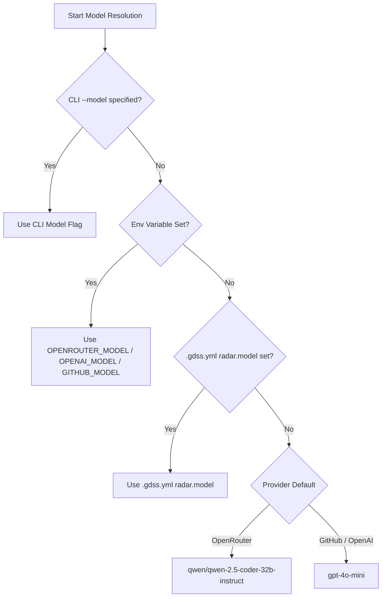

# ⚙️ GDSS Repository Configuration Guide (`.gdss.yml`)

> **The Definitive Guide to Configuring `.gdss.yml` for Predictable Models, Explicit Context Windows, Agentic Refinement Loops, and CI/CD Collision Radar.**

---

## 📑 Table of Contents
- [Overview: Why Explicit Configuration Matters](#-overview-why-explicit-configuration-matters)
- [The Golden Rule: Avoid Unintended Fallbacks](#-the-golden-rule-avoid-unintended-fallbacks)
- [Complete Production `.gdss.yml` Template](#-complete-production-gdssyml-template)
- [Detailed Schema Reference](#-detailed-schema-reference)
  - [`radar` (AI Convergence & CI Radar)](#1-radar-ai-convergence--ci-radar)
  - [`validation` (Ephemeral Sandbox Worktrees)](#2-validation-ephemeral-sandbox-worktrees)
  - [`ast` (Multi-Language & DSL Tracking)](#3-ast-multi-language--dsl-tracking)
  - [`hierarchy` (Branch Selection & Attractor Precedence)](#4-hierarchy-branch-selection--attractor-precedence)
- [🌳 Branch Hierarchy & Selection Guide](#-branch-hierarchy--selection-guide)
  - [The Core Rationale: Why Unconstrained N × N Fails](#the-core-rationale-why-unconstrained-n--n-fails)
  - [Precedence & Resolution Cascade](#precedence--resolution-cascade)
  - [The 4 Deployment Mode Recipes](#the-4-deployment-mode-recipes)
    - [Mode 1: GitHub Actions CI (`gdss audit-pr`)](#mode-1-github-actions-ci-gdss-audit-pr)
    - [Mode 2: Local CLI & Interactive Shell (`gdss` / `gdss start`)](#mode-2-local-cli--interactive-shell-gdss--gdss-start)
    - [Mode 3: IDE MCP Tool Server (Cursor / Claude Code / Copilot)](#mode-3-ide-mcp-tool-server-cursor--claude-code--copilot)
    - [Mode 4: Web Visual Dashboard & REST API](#mode-4-web-visual-dashboard--rest-api)
  - [Configuration Matrix: `.gdss.yml` vs Runtime DB](#configuration-matrix-gdssyml-vs-runtime-db)
- [🧠 Comprehensive Model Configuration & Provider Guide](#-comprehensive-model-configuration--provider-guide)
  - [1. The Universal OpenAI-Compatible Standard](#1-the-universal-openai-compatible-standard)
  - [1.1 Provider Authentication Matrix Across All 4 Deployment Modes](#11-provider-authentication-matrix-across-all-4-deployment-modes)
  - [2. The 3 Ways to Configure Models](#2-the-3-ways-to-configure-models)
  - [3. Model Precedence & Resolution Cascade](#3-model-precedence--resolution-cascade)
  - [4. Modern Model Setup: Zero-Cost CI & Microsoft Azure AI Foundry](#4-modern-model-setup-zero-cost-ci--microsoft-azure-ai-foundry)
  - [5. Model Selection Guide & Suitability Matrix](#5-model-selection-guide--suitability-matrix)
  - [6. Context Window Budgeting & Condensation Math](#6-context-window-budgeting--condensation-math)
  - [7. Provider-Specific Recipes](#7-provider-specific-recipes)
    - [Recipe A: DeepSeek Direct (High Performance, Ultra-Low Cost)](#recipe-a-deepseek-direct-high-performance-ultra-low-cost)
    - [Recipe B: Groq (Ultra-Fast LPU Inference)](#recipe-b-groq-ultra-fast-lpu-inference)
    - [Recipe C: Local LM Studio / LocalAI (Zero Cost, No API Key)](#recipe-c-local-lm-studio--localai-zero-cost-no-api-key)
    - [Recipe D: Microsoft Azure AI Foundry (Official Microsoft Successor)](#recipe-d-microsoft-azure-ai-foundry-official-microsoft-successor)
    - [Recipe E: OpenRouter (Multi-Model Gateway & Free Tier)](#recipe-e-openrouter-multi-model-gateway--free-tier)
    - [Recipe F: OpenAI Direct & Azure OpenAI](#recipe-f-openai-direct--azure-openai)
    - [Recipe G: Local Ollama (Offline Developer Workstation)](#recipe-g-local-ollama-offline-developer-workstation)
    - [Recipe H: Private vLLM Cluster](#recipe-h-private-vllm-cluster)
    - [Recipe I: GitHub Copilot CLI (Copilot Business / Enterprise)](#recipe-i-github-copilot-cli-copilot-business--enterprise)
  - [8. Model Troubleshooting & Common Issues](#8-model-troubleshooting--common-issues)
  - [9. Complete Environment Variable Reference Table](#9-complete-environment-variable-reference-table)
- [What to Expect After Integration](#-what-to-expect-after-integration)
  - [In Pull Requests (GitHub Actions CI)](#1-in-pull-requests-github-actions-ci)
  - [In Local Development (CLI)](#2-in-local-development-cli)
  - [In IDEs (Cursor / Claude Code / Copilot MCP)](#3-in-ides-cursor--claude-code--copilot-mcp)

---

## 🎯 Overview: Why Explicit Configuration Matters

GDSS is designed to be **Zero-Config by Default**: out of the box, it inspects your Git DAG, parses syntax trees across dozens of programming languages, and uses multi-tier fallbacks to guess model context windows and locate build descriptors.

However, in production repositories and team workflows, **explicit configuration in `.gdss.yml` is strongly recommended**. 

Committing a `.gdss.yml` to the root of your repository ensures that:
1. **Every Developer and CI Runner Shares Identical Settings**: No discrepancy between local laptop runs (`gdss suggest`) and GitHub Actions (`gdss audit-pr`).
2. **Context Budgets Are Exact**: The symbol condensation engine allocates up to 45% of your declared context window (up to 96,000 characters) for rich symbol implementations, caller/callee graphs, and commit histories.
3. **Agentic Self-Correction Bounds Are Defined**: You control exactly how many times the agent iterates against compiler and test traces before presenting a solution to humans.

---

## 🛡️ The Golden Rule: Avoid Unintended Fallbacks

GDSS includes a 3-tier dynamic discovery system for context window sizing:
- **Tier 1**: User configuration (`.gdss.yml` `context_window` or CLI `--context-window`).
- **Tier 2**: Dynamic discovery via provider API (`/models` or `/api/show`).
- **Tier 3**: Pattern matching heuristics (`gpt-4o` ➔ 128k, `claude-3` ➔ 200k, fallback ➔ 16k).

### Why You Should NOT Rely on Tier 2 or Tier 3 Fallbacks

| Risk with Fallbacks | What Happens in Practice | How Explicit `.gdss.yml` Solves It |
| :--- | :--- | :--- |
| **API Gateway Inconsistencies** | Custom enterprise proxies, Azure OpenAI, or self-hosted gateways frequently omit `context_length` from `/models` responses. | Setting `context_window` guarantees the exact token ceiling without querying gateway metadata. |
| **Conservative 16k Fallback** | If an unfamiliar or fine-tuned model name is used (e.g. `my-team-coder-v2`), Tier 3 defaults to a conservative 16,384 tokens, severely constricting the code symbol budget. | Explicit configuration unlocks the full 32k, 64k, or 128k+ capacity of your fine-tuned model. |
| **Unnecessary Latency** | Querying `/models` or `/api/show` introduces extra HTTP round trips on every CLI command or CI job. | Pre-configured values are resolved instantaneously in memory ($0\text{ ms}$ overhead). |
| **Unexpected Truncation** | Heuristic estimates can lead to unexpected ellipsis condensation (`/* ... N lines condensed ... */`) if a model's true window is larger than the heuristic. | Full functions, interfaces, and cross-file callers fit into the prompt cleanly. |

> [!IMPORTANT]
> **Always declare `model`, `context_window`, and `max_refinements` explicitly in `.gdss.yml`.** Do not let your CI pipeline rely on heuristic fallbacks or network discovery.

---

## 📋 Complete Production `.gdss.yml` Template

Copy and paste this template into `.gdss.yml` at the root of your repository:

```yaml
# .gdss.yml - GDSS Semantic Repository Intelligence Configuration
# Check this file into Git root so CI, CLI, and IDE agents share identical rules.

# ==============================================================================
# 1. AI Convergence & PR Collision Radar
# ==============================================================================
radar:
  # The model to invoke for semantic patch reconciliation
  # Examples: "gpt-4o", "gpt-4o-mini", "deepseek-chat", "llama-3.3-70b-versatile", "qwen2.5-coder:7b"
  model: "gpt-4o"

  # Explicit context window size in tokens (MANDATORY BEST PRACTICE)
  # Unlocks full code condensation budget without relying on heuristic fallbacks
  # - gemini-1.5-pro / 2.0-pro: 2000000
  # - gemini-1.5-flash / 2.0-flash: 1000000
  # - claude-3-5-sonnet: 200000
  # - gpt-4o / o1 / o3: 128000
  # - deepseek-chat: 64000
  # - qwen2.5-coder: 32768
  context_window: 128000

  # Inference provider backend
  # Options: "openrouter" (default, recommended free tier), "copilot" (GitHub Copilot CLI), "azure", "openai", "ollama", "vllm", or "openai-compatible"
  provider: "openrouter"

  # Optional custom OpenAI-compatible base URL (Universal Protocol)
  # Set this to use ANY OpenAI-compatible provider (DeepSeek, Groq, Together, LM Studio, etc.)
  # Examples:
  # - DeepSeek: "https://api.deepseek.com/v1"
  # - Groq: "https://api.groq.com/openai/v1"
  # - LM Studio (Local): "http://localhost:1234/v1"
  # - Ollama (Local): "http://localhost:11434/v1"
  # If omitted, GDSS resolves base_url automatically from provider and API keys.
  base_url: ~

  # Maximum agentic self-correction iterations when sandboxed validation fails
  # If the initial patch fails syntax, typecheck, or tests, the error trace is fed
  # back to the model up to this limit to iteratively heal the patch.
  # Default: 2 (Recommended: 2 or 3)
  max_refinements: 2

  # Maximum concurrent worker threads for parallel conflict drafting
  # Default: 4
  concurrency_limit: 4

  # Context preservation policy:
  # - "lossless" (default): preserves 100% of code tokens without aggressive truncation
  # - "ast_minimal": keeps AST symbol signatures and bodies only
  # - "off": passes raw context with zero filtering
  condensation: "lossless"

  # Collision risk cutoff score between 0.0 and 1.0 (Omega_ij)
  # Collisions at or above this threshold trigger alerts and suggestions
  # Default: 0.8 (Critical / High Risk)
  risk_threshold: 0.8

  # CI Merge Gate Behavior
  # - false: Informational mode (posts sticky radar comment with 1-click suggestions without blocking CI)
  # - true: Enforcing mode (fails CI check with exit code 1 if Omega_ij >= risk_threshold)
  fail_on_collision: false

# ==============================================================================
# 2. Ephemeral Sandbox Validation
# ==============================================================================
validation:
  # Command used for targeted unit test execution in ephemeral worktrees
  # {test_file} placeholder is automatically substituted with matching test files
  test_command: "pytest {test_file}"

  # Command used for static type verification in ephemeral worktrees
  typecheck_command: "mypy ."

  # Command used for custom linting or syntax checks
  syntax_command: "ruff check ."

  # Execution timeout in seconds for validation commands
  # Default: 30 (Use 60-120s for larger test suites)
  timeout_seconds: 45

# ==============================================================================
# 3. AST Parsing & Multi-Language Scanning
# ==============================================================================
ast:
  # Additional file extensions to track in collision radar and dependency graphs
  # Standard extensions (.py, .ts, .js, .go, .rs, .java, .c, .cpp, .cs, .rb, etc.)
  # are tracked automatically. Use this for web frameworks, templates, or DSLs.
  additional_extensions:
    - .vue
    - .svelte
    - .sol
    - .zig

# ==============================================================================
# 4. Branch Selection & Hierarchy Precedence
# ==============================================================================
hierarchy:
  # The default attractor (base) branch against which drift and collisions are computed
  reference_branch: "main"

  # Ordered priority chain defining landing precedence and attractor hierarchy
  priority_chain:
    - "main"
    - "develop"
    - "staging"

  # In CI, only evaluate concurrent PRs that share the exact same base landing branch
  # Set to true (default) to prevent comparing hotfixes to v1.2 against feature PRs to develop
  same_base_only: true

  # Glob patterns or branch names to include in collision radar and drift analysis
  # If empty, all active branches are evaluated (subject to exclusions)
  include:
    - "feature/*"
    - "fix/*"
    - "pr-*"

  # Glob patterns or branch names to exclude from collision radar and drift analysis
  exclude:
    - "spike/*"
    - "archive/*"
    - "gh-pages"
    - "dependabot/*"

  # Allowed PR target base branches for CI collision radar
  target_bases:
    - "main"
    - "develop"
```

---

## 🔍 Detailed Schema Reference

### 1. `radar` (AI Convergence & CI Radar)

| Directive | Type | Default | Description |
| :--- | :---: | :---: | :--- |
| `radar.model` | `string` | `"gpt-4o-mini"` | The exact model identifier dispatched for code reconciliation. |
| `radar.context_window` | `integer` | *Dynamic* | **Required best practice.** The exact context window capacity in tokens (e.g. `1000000` for Gemini Flash, `128000` for GPT-4o). Precludes fallback guessing and maximizes lossless code budget. |
| `radar.concurrency_limit` | `integer` | `4` | Maximum concurrent worker threads for parallel conflict drafting. |
| `radar.condensation` | `string` | `"lossless"` | Context condensation policy: `"lossless"` (preserves 100% of code when budget allows), `"ast_minimal"`, or `"off"`. See [`PARALLEL_ORCHESTRATION_AND_CONTEXT_GUIDE.md`](PARALLEL_ORCHESTRATION_AND_CONTEXT_GUIDE.md). |
| `radar.provider` | `string` | `"auto"` | Target provider: `"github"`, `"openai"`, `"openrouter"`, `"ollama"`, `"vllm"`, or `"openai-compatible"`. |
| `radar.base_url` | `string \| null` | `null` | Custom OpenAI-compatible base URL (e.g. `https://api.deepseek.com/v1`). Connects GDSS to any standard compliant endpoint. |
| `radar.max_refinements` | `integer` | `2` | Number of automated self-correction retries inside the ephemeral sandbox worktree before halting. |
| `radar.risk_threshold` | `float` | `0.8` | Semantic interaction threshold ($\Omega_{ij} \in [0.0, 1.0]$) determining when a collision is flagged. |
| `radar.fail_on_collision` | `boolean` | `false` | When `true`, exits with status `1` on high-risk collisions to block PR merges until resolved. |

### 2. `validation` (Ephemeral Sandbox Worktrees)

| Directive | Type | Default | Description |
| :--- | :---: | :---: | :--- |
| `validation.test_command` | `string` | *Auto-detected* | Shell command to execute targeted regression tests. Supports `{test_file}` replacement. |
| `validation.typecheck_command` | `string` | *Auto-detected* | Shell command to execute static typechecking (`mypy`, `tsc --noEmit`, `cargo check`). |
| `validation.syntax_command` | `string` | *Auto-detected* | Shell command to execute syntax checks or linters. |
| `validation.timeout_seconds` | `integer` | `30` | Worktree execution timeout in seconds. Prevents hanging tests from stalling CI. |

### 3. `ast` (Multi-Language & DSL Tracking)

| Directive | Type | Default | Description |
| :--- | :---: | :---: | :--- |
| `ast.additional_extensions` | `list[str]` | `[]` | List of custom file extensions (e.g. `[.vue, .sol]`) mapped into symbol extraction. |
| `ast.exclude_patterns` | `list[str]` | `[]` | Glob patterns of paths or files to exclude from AST symbol parsing (e.g. `["node_modules/**", "dist/**", "vendor/**"]`). |

### 4. `hierarchy` (Branch Selection & Attractor Precedence)

| Directive | Type | Default | Description |
| :--- | :---: | :---: | :--- |
| `hierarchy.reference_branch` | `string` | `"main"` | The primary attractor branch representing canonical repository state. |
| `hierarchy.priority_chain` | `list[str]` | `["main", "develop", "staging"]` | Ordered list of authoritative branches consulted during rebase topology generation and fallback resolution. |
| `hierarchy.same_base_only` | `boolean` | `true` | When `true`, CI PR Collision Radar strictly evaluates PRs sharing the exact same base ref (e.g. `develop`), eliminating false-positive collisions across disparate release targets. |
| `hierarchy.include` | `list[str]` | `[]` | Glob patterns or branch names included in analysis (e.g. `["feature/*", "fix/*"]`). If empty, all active non-attractor branches are candidates. |
| `hierarchy.exclude` | `list[str]` | `[]` | Glob patterns or branch names ignored during analysis (e.g. `["spike/*", "archive/*"]`). |
| `hierarchy.target_bases` | `list[str]` | `[]` | Allowed PR landing target branches in CI. If provided, PRs targeting branches outside this list are ignored. |

---

## 🌳 Branch Hierarchy & Selection Guide

### The Core Rationale: Why Unconstrained N × N Fails

In real-world enterprise repositories with dozens or hundreds of branches, calculating unconstrained pairwise interaction ($\Omega_{ij}$) across **all** branches is both computationally wasteful and semantically misleading:

1. **Disparate Landing Targets**: A hotfix branch targeting `v1.2-patch` does not compete for landing against a long-term feature branch targeting `develop`. Comparing them produces false-positive collision alarms because their merge bases and downstream destinations are completely different.
2. **Abandoned Spikes and Experimental Prototypes**: Long-lived exploratory branches (e.g. `spike/wasm-runtime-2024`) frequently modify fundamental symbols. Without scoping, GDSS would continually flag collisions between active production PRs and dormant prototypes.
3. **Combinatorial Noise**: For $N=60$ branches, pure unconstrained evaluation requires $\binom{60}{2} = 1,770$ pairwise comparisons. Scoping to active feature PRs sharing a landing base reduces this to $\binom{4}{2} = 6$ comparisons, speeding up analysis by over **99%**.

GDSS resolves this through **Branch Hierarchy and Selection Scoping**: you define which branches participate in collision radar and drift tracking, establish priority chains for merge ordering, and filter out noise across all four deployment modes.

```
                      [ Canonical Attractor ]
                             ( main )
                                ▲
                                │ Priority Chain
                           ( develop )
                                ▲
            ┌───────────────────┴───────────────────┐
     [ Included Scope ]                      [ Excluded Scope ]
   ( feature/billing )                     ( spike/wasm-spike )
   ( feature/auth    )                     ( dependabot/*     )
          │                                         │
          └───► Pairwise Radar (Ω_auth, billing)     └───► Filtered Out ($0 Noise)
```

---

### Precedence & Resolution Cascade

GDSS resolves branch configuration and filtering rules through a deterministic 4-tier precedence cascade:

```
┌────────────────────────────────────────────────────────────────────────┐
│ 1. Invocation Flag (Highest Precedence)                                │
│    CLI --branches / --exclude / --same-base-only                       │
│    MCP tool parameters: branches=[...], exclude_branches=[...]         │
│    REST API query: ?branches=...&exclude=...                           │
├────────────────────────────────────────────────────────────────────────┤
│ 2. Local Database Override (.gdss/runtime.db)                          │
│    Set via interactive shell: config branches include/exclude/clear    │
│    Set via interactive shell: config hierarchy <chain...>              │
│    Persisted per-developer on local workstation                        │
├────────────────────────────────────────────────────────────────────────┤
│ 3. Repository Configuration (.gdss.yml)                                │
│    Committed to Git root: hierarchy.include, hierarchy.exclude,        │
│    hierarchy.priority_chain, hierarchy.same_base_only                  │
├────────────────────────────────────────────────────────────────────────┤
│ 4. Heuristic Fallback (Lowest Precedence)                              │
│    Attractor = "main", all non-attractor Git branches considered       │
└────────────────────────────────────────────────────────────────────────┘
```

---

### The 4 Deployment Mode Recipes

#### Mode 1: GitHub Actions CI (`gdss audit-pr`)

In CI, GDSS automatically filters concurrent PRs so that only pull requests targeting the same destination or matching inclusion patterns are evaluated.

**Recipe 1: Declarative `.gdss.yml` for Multi-Track Teams**
```yaml
# .gdss.yml
hierarchy:
  reference_branch: "main"
  priority_chain:
    - "main"
    - "develop"
  # Strictly avoid comparing PRs targeting main with PRs targeting v2.0-lts
  same_base_only: true
  include:
    - "feature/*"
    - "fix/*"
  exclude:
    - "spike/*"
    - "dependabot/*"
    - "chore/*"
  target_bases:
    - "main"
    - "develop"
```

**Recipe 2: CI Workflow Command Line Overrides**
You can also override branch filters directly in `.github/workflows/gdss-radar.yml`:
```yaml
- name: Run GDSS PR Collision Radar
  run: |
    # Audit PR #42 against specific candidate branches with strict same-base isolation
    gdss audit-pr --repo . --pr-number ${{ github.event.pull_request.number }} \
      --branches "feature/*" \
      --exclude "dependabot/*" \
      --same-base-only
```

---

#### Mode 2: Local CLI & Interactive Shell (`gdss` / `gdss start`)

Developers working locally can scope the collision radar on demand using CLI flags or persist their preferences in `.gdss/runtime.db`.

**One-Off CLI Commands:**
```bash
# 1. Audit drift against specific feature branches only
gdss drift --repo . --ref main --branches feature/auth --branches feature/billing

# 2. Compute conflict tensor while excluding experimental spikes
gdss tensor --repo . --ref main --exclude "spike/*" --exclude "archive/*"

# 3. Generate AI suggestions with explicit branch scoping
gdss suggest --repo . --ref main -b feature/auth -b feature/billing --validate
```

**Interactive Shell (`gdss start`) Persistence:**
Configure filters once in the interactive shell; they are saved in `.gdss/runtime.db` and persist across CLI sessions:
```bash
gdss start
```
```
gdss (main)> config hierarchy main develop staging
Updated priority chain in database: ['main', 'develop', 'staging']

gdss (main)> config branches include feature/* fix/*
Added 2 include branch pattern(s) to runtime database.

gdss (main)> config branches exclude spike/* test-*
Added 2 exclude branch pattern(s) to runtime database.

gdss (main)> hierarchy
Attractor: main
Priority Chain: ['main', 'develop', 'staging']
Active Branch Filters:
  Include: ['feature/*', 'fix/*']
  Exclude: ['spike/*', 'test-*']

gdss (main)> tensor
# Runs pairwise Ω_ij ONLY across branches matching include patterns
```
To clear runtime database overrides and revert to `.gdss.yml`:
```
gdss (main)> config branches clear
Cleared branch filters from runtime database.
```

---

#### Mode 3: IDE MCP Tool Server (Cursor / Claude Code / Copilot)

When developers ask their AI assistant (*"Are my changes going to collide with the upcoming billing refactor?"*), the assistant calls GDSS MCP tools with explicit branch filters:

**Tool Input Schema (`gdss_find_collisions`):**
```json
{
  "name": "gdss_find_collisions",
  "arguments": {
    "repo_path": "/home/developer/projects/GDSS",
    "reference_branch": "main",
    "branches": ["feature/auth", "feature/billing"],
    "exclude_branches": ["spike/*"]
  }
}
```

**MCP Example Interaction in Cursor / Claude Code:**
> **Developer:** *"Run collision radar comparing my branch with feature/billing, ignoring any spikes."*  
> **Assistant:** Dispatches `gdss_find_collisions` with `branches=["feature/billing"]` and `exclude_branches=["spike/*"]`. GDSS calculates $\Omega_{ij}$ in $0\text{ ms}$ token cost, and the assistant returns:
> *"No collision detected on authentication tokens; 1 non-commutative edit detected on `config/database.go:Connect()`."*

Supported MCP Tools:
- `gdss_find_collisions(repo_path, reference_branch, branches, exclude_branches)`
- `gdss_get_merge_order(repo_path, reference_branch, branches, exclude_branches)`
- `gdss_plan_semantic_rebase(repo_path, reference_branch, branches, exclude_branches)`

---

#### Mode 4: Web Visual Dashboard & REST API

The GDSS web dashboard and HTTP REST server provide both programmatic query parameters and interactive UI controls.

**REST API Endpoints:**
```bash
# Query Conflict Tensor with branch scoping
curl "http://localhost:8000/v1/tensor?ref=main&branches=feature%2Fauth%2Cfeature%2Fbilling&exclude=spike-*"

# Query Semantic Drift with branch scoping
curl "http://localhost:8000/v1/drift?ref=main&branches=feature%2Fauth"

# Inspect Active Hierarchy and Filters
curl "http://localhost:8000/v1/hierarchy"

# Update Hierarchy and Filters Dynamically via POST
curl -X POST "http://localhost:8000/v1/hierarchy" \
  -H "Content-Type: application/json" \
  -d '{
    "priority_chain": ["main", "develop", "staging"],
    "include": ["feature/*"],
    "exclude": ["spike/*"]
  }'
```

**Interactive UI Control (`RepoRefPicker`):**
In the dashboard top bar:
1. **Ref Selector**: Select the attractor base branch (e.g. `main`).
2. **Scope Filter Popover**: Click **"Scope: All branches (5)"** to open the interactive popover.
3. Select or deselect specific candidate branches using the checkboxes.
4. The Conflict Tensor ($\Omega$) and Drift Radar immediately re-render to reflect the selected branch subset.
5. Click **"Reset (All)"** to clear active filters.

---

### Configuration Matrix: `.gdss.yml` vs Runtime DB

| Dimension | `.gdss.yml` (Repository Config) | `.gdss/runtime.db` (Local SQLite DB) |
| :--- | :--- | :--- |
| **Location** | Checked into Git root (`.gdss.yml`) | Stored in local directory (`.gdss/runtime.db`) |
| **Scope** | Shared across all developers and CI runners | Developer-local workstation override |
| **Persistence** | Version-controlled in Git | Persists across terminal sessions on local laptop |
| **Best For** | CI pipeline policies, repository-wide branch conventions, team defaults | Personal developer focus, temporary debugging, ignoring personal branches |
| **How to Set** | Edit `.gdss.yml` file | Run `config hierarchy` or `config branches` in `gdss start` |
| **How to Reset** | `git checkout .gdss.yml` | `config branches clear` in `gdss start` |
| **CI Support** | Native (read automatically by `gdss audit-pr`) | Not checked into Git (ephemeral per runner) |

---

## 🧠 Comprehensive Model Configuration & Provider Guide

### 1. The Universal OpenAI-Compatible Standard

GDSS is designed from first principles to be **completely provider-agnostic**. It does **not** bind your repository to proprietary OpenAI APIs or require specific vendor billing accounts.

Internally, GDSS’s core LLM client is [OpenAICompatibleProvider](file:///home/sarakb/projects/GDSS/gdss/ai/openai_provider.py#L17-L110). It implements the universal open standard:
```http
POST /v1/chat/completions
Content-Type: application/json
Authorization: Bearer <API_KEY_OR_TOKEN>

{
  "model": "<MODEL_NAME>",
  "messages": [{"role": "user", "content": "<PROMPT>"}],
  "temperature": 0.0
}
```

Because of this universal standard, **any provider or server that supports the OpenAI Chat Completions API can be used with GDSS out of the box**:

| Provider Category | Supported Services & Gateways | Base URL Example |
| :--- | :--- | :--- |
| **Cloud Frontier APIs** | DeepSeek, OpenAI, Azure OpenAI, Groq, Together AI, Mistral AI, Fireworks AI, Cerebras | `https://api.deepseek.com/v1`<br>`https://api.groq.com/openai/v1` |
| **Aggregator Gateways** | OpenRouter, Cloudflare Workers AI | `https://openrouter.ai/api/v1` |
| **Enterprise Cloud / Azure** | Microsoft Azure AI Foundry (Azure OpenAI Service) | `https://<resource>.openai.azure.com/openai/v1` |
| **Local / Developer Laptop** | LM Studio, LocalAI, Jan.ai, Ollama, vLLM | `http://localhost:1234/v1`<br>`http://localhost:11434/v1` |
| **Enterprise Proxies** | LiteLLM Proxy, Portkey, Kong AI Gateway | `http://proxy.internal.corp/v1` |

> [!TIP]
> **Keyless Local Inference**: For local servers like LM Studio or LocalAI that do not require authentication, GDSS automatically omits the `Authorization: Bearer` header when no key is configured. You do not need to generate dummy tokens.

---

### 1.1 Provider Authentication Matrix Across All 4 Deployment Modes

Developers frequently ask where model credentials and API keys must be provided across GDSS's operational surfaces. The table below outlines how each deployment mode handles credentials and authentication:

| Deployment Mode | Where Secrets Are Configured | Environment Variables / Headers | Needs Model API Key? | Token Cost to Project |
| :--- | :--- | :--- | :---: | :---: |
| **Mode 1: GitHub Actions CI** (`gdss audit-pr`) | GitHub Repository Secrets (`Settings ➔ Secrets and variables ➔ Actions`) | Passed into workflow step: `GITHUB_TOKEN: ${{ secrets.GITHUB_TOKEN }}` (PR diffs/comments), optional `OPENROUTER_API_KEY: ${{ secrets.OPENROUTER_API_KEY }}` | **Optional** (Zero keys for deterministic radar; key needed for AI patches) | **$0** with OpenRouter Free Tier or Groq Free Tier |
| **Mode 2: Local CLI & Shell** (`gdss suggest`, `gdss start`) | Local shell profile (`~/.bashrc`, `~/.zshrc`) or `.env` file | `export GITHUB_TOKEN="ghp_..."`<br>`export OPENAI_API_KEY="sk-..."` | **Yes** (only for `gdss suggest --validate` with LLM) | Developer account or local free model (Ollama/LM Studio) |
| **Mode 3: IDE MCP Tool Server** (Cursor / Claude Code / Copilot) | **No secrets required** in MCP server config (`~/.cursor/mcp.json`) | None (runs via JSON-RPC stdio over local CLI) | **NO** (Zero keys needed) | **$0 Token Bleed** (powered by developer's IDE account) |
| **Mode 4: Web Visual Dashboard & REST API** (`web/` & `gdss serve`) | Inherited by `gdss serve` daemon process from the host shell | `GITHUB_TOKEN` or `OPENAI_API_KEY` in server shell | **Optional** (Deterministic views need 0 keys) | **$0** for all radar, tensor, and drift views |

> [!IMPORTANT]
> **MCP Tool Server Zero Token Bleed Guarantee**: When using Cursor, Claude Code, or Copilot with `gdss mcp`, GDSS exposes purely deterministic analysis tools (`find_collisions`, `get_merge_order`, `inspect_symbol_impact`, `validate_patch`). The chat LLM is powered directly by your IDE subscription. GDSS runs 100% locally on CPU and **never requires an external LLM API key in MCP mode**.

---

### 2. The 3 Ways to Configure Models

GDSS gives you three complementary mechanisms to configure inference models:

#### Method 1: Declarative Repository Configuration (`.gdss.yml`)
Committed to the root of your Git repository. This is the **authoritative team standard** that ensures local laptop runs (`gdss suggest`) and GitHub Actions runners (`gdss audit-pr`) use identical model behaviors:

```yaml
# .gdss.yml
radar:
  provider: "openai-compatible"           # Provider type
  base_url: "https://api.deepseek.com/v1" # Custom endpoint URL
  model: "deepseek-chat"                  # Model identifier
  context_window: 64000                   # Exact token limit
  max_refinements: 2                      # Sandboxed heal retries
```

#### Method 2: Runtime Environment Variables
Used in CI/CD secrets management, automated deployment containers, and personal developer shell profiles (`~/.bashrc`, `~/.zshrc`):

| Environment Variable | Purpose | Supported Values |
| :--- | :--- | :--- |
| `OPENAI_BASE_URL` | Universal endpoint URL override | Any HTTP/HTTPS URL (e.g. `https://api.groq.com/openai/v1`) |
| `OPENAI_API_KEY` | Universal Bearer token | API key for OpenAI, DeepSeek, Groq, or enterprise proxies |
| `OPENROUTER_API_KEY` | OpenRouter gateway secret | Automatically defaults base URL to `https://openrouter.ai/api/v1` |
| `AZURE_OPENAI_API_KEY` | Microsoft Azure AI Foundry / Azure OpenAI key | API key for Azure AI Foundry model deployments |
| `AZURE_OPENAI_ENDPOINT` | Azure AI Foundry endpoint | e.g. `https://<resource>.openai.azure.com/openai/v1` |
| `GITHUB_TOKEN` | GitHub repository token | Exclusively for GitHub REST API (fetching PRs, posting sticky comments) |
| `OPENROUTER_MODEL` | OpenRouter default model override | e.g. `qwen/qwen-2.5-coder-32b-instruct` |
| `AZURE_OPENAI_MODEL` | Azure AI Foundry deployment name override | e.g. `gpt-4o`, `gpt-4o-mini`, `phi-4` |
| `OPENAI_MODEL` | OpenAI / Custom endpoint model override | e.g. `deepseek-chat`, `gpt-4o` |
| `GDSS_CONTEXT_WINDOW` | Explicit context window token capacity | e.g. `128000`, `64000` |

#### Method 3: Runtime CLI Flags
Ideal for one-off experimentation, testing newly released models, or benchmarking different providers without modifying committed files:

```bash
# 1. Test convergence with a custom model and provider
gdss suggest --repo . --ref main \
  --provider openrouter \
  --model anthropic/claude-3.5-sonnet \
  --context-window 200000 \
  --validate --llm

# 2. Run PR collision audit in CI with a specific model override
gdss audit-pr --repo . --pr-number 42 \
  --model gpt-4o \
  --context-window 128000
```

---

### 3. Model Precedence & Resolution Cascade

When GDSS resolves which model and endpoint to invoke, it follows a strict 4-tier precedence hierarchy:

```
┌────────────────────────────────────────────────────────────────────────┐
│ 1. Invocation Flag (Highest Precedence)                                │
│    CLI --model, --provider, --context-window                           │
│    Overrides all environment variables and configuration files.        │
├────────────────────────────────────────────────────────────────────────┤
│ 2. Environment Variables                                               │
│    OPENROUTER_MODEL, OPENAI_MODEL, GITHUB_MODEL, OPENAI_BASE_URL       │
│    Allows CI runners and developer shells to inject secrets & overrides│
├────────────────────────────────────────────────────────────────────────┤
│ 3. Repository Configuration (.gdss.yml)                                │
│    radar.model, radar.base_url, radar.provider, radar.context_window   │
│    The committed team baseline versioned in Git.                       │
├────────────────────────────────────────────────────────────────────────┤
│ 4. Provider Default (Lowest Precedence)                                │
│    OpenRouter: qwen/qwen-2.5-coder-32b-instruct                        │
│    Azure AI Foundry / OpenAI: gpt-4o-mini                              │
└────────────────────────────────────────────────────────────────────────┘
```



---

### 4. Zero-Cost CI & Local Model Setup (Post-GitHub Models Retirement)

> [!WARNING]
> **GitHub Models Retired (July 30, 2026)**  
> GitHub officially shut down its Models playground, catalog, inference API (`models.inference.ai.azure.com`), and BYOK services on **July 30, 2026** (see [GitHub Changelog Announcement](https://github.blog/changelog/2026-07-01-github-models-is-being-fully-retired-on-July-30-2026/)).  
> **Creating a GitHub Personal Access Token (`GH_MODELS_PAT`) will no longer grant inference access.**
>
> In GitHub Actions CI, `GITHUB_TOKEN` is used strictly for repository and PR operations (listing open PRs, posting sticky radar markdown comments, and checking out code). It is not an inference token.

For $0-cost or ultra-low-cost CI collision radar and local development, use the following modern alternatives:

```
                  ┌──────────────────────────────────────────┐
                  │    GDSS Execution Surface (CI or CLI)    │
                  └────────────────────┬─────────────────────┘
                                       │
         ┌─────────────────────────────┼─────────────────────────────┐
         ▼                             ▼                             ▼
  [ OpenRouter Free Tier ]      [ Groq LPU / DeepSeek ]       [ Local Offline (Ollama) ]
  • Free coder models           • Sub-second inference        • 100% offline ($0 cost)
  • qwen/qwen-2.5-coder-32b     • llama-3.3-70b / deepseek    • qwen2.5-coder:7b
  • OPENROUTER_API_KEY          • OPENAI_API_KEY / BASE_URL   • Zero cloud dependency
```

#### A. Option 1: OpenRouter Free Tier (Recommended CI Default)
OpenRouter provides free access to capable coder models (e.g. `qwen/qwen-2.5-coder-32b-instruct`):

1. **Sign Up**: Create an account at [OpenRouter.ai](https://openrouter.ai).
2. **Generate API Key**: Create an API key under Account Settings.
3. **In `.gdss.yml`**:
   ```yaml
   radar:
     provider: "openrouter"
     model: "qwen/qwen-2.5-coder-32b-instruct"
     context_window: 32768
     max_refinements: 2
   ```
4. **In GitHub Actions CI (`.github/workflows/gdss-radar.yml`)**:
   Add `OPENROUTER_API_KEY` to repository secrets (**Settings ➔ Secrets and variables ➔ Actions**):
   ```yaml
   - name: Run GDSS PR Collision Radar
     env:
       GITHUB_TOKEN: ${{ secrets.GITHUB_TOKEN }} # Used for GitHub PR comments & checkout
       OPENROUTER_API_KEY: ${{ secrets.OPENROUTER_API_KEY }} # Used for free AI patch synthesis
     run: |
       gdss audit-pr --repo . --pr-number ${{ github.event.pull_request.number }}
   ```
5. **In Local CLI**:
   ```bash
   export OPENROUTER_API_KEY="sk-or-v1-..."
   gdss suggest --validate
   ```

#### B. Option 2: Deterministic Radar Mode ($0 Compute, Zero AI Keys Needed)
If you do not configure an `OPENROUTER_API_KEY` or `OPENAI_API_KEY` in CI, GDSS **does not crash or fail**:
- It runs the entire **Deterministic PR Collision Radar** on CPU at $0 token cost.
- It computes the $\Omega_{ij}$ interaction matrix, identifies clashing files and symbols, detects non-commutative AST changes, and calculates the optimal merge order sequence.
- The sticky PR comment displays the full risk table, conflict topology, and recommendations. Only the optional ` ```suggestion ` AI patch generation is omitted.

#### C. Option 3: Groq LPU or DeepSeek Direct
For high-speed or low-cost commercial models:
- **Groq** (`llama-3.3-70b-versatile`): Free / minimal cost, < 2s response time.
  ```yaml
  radar:
    provider: "openai-compatible"
    base_url: "https://api.groq.com/openai/v1"
    model: "llama-3.3-70b-versatile"
    context_window: 128000
  ```
- **DeepSeek Direct** (`deepseek-chat`):
  ```yaml
  radar:
    provider: "openai-compatible"
    base_url: "https://api.deepseek.com/v1"
    model: "deepseek-chat"
    context_window: 64000
  ```

#### D. Option 4: Local Workstation (Ollama / LM Studio)
For offline developers and air-gapped environments:
```bash
ollama run qwen2.5-coder:7b
```
```yaml
radar:
  provider: "ollama"
  model: "qwen2.5-coder:7b"
  context_window: 32768
```

#### E. Option 5: GitHub Copilot CLI in CI (Copilot Business / Enterprise Organizations)
If your repository is owned by a GitHub Organization with a Copilot Business or Enterprise subscription, you can use the `@github/copilot` CLI as a stateless inference provider authenticated by the runner's native `GITHUB_TOKEN`:

> [!IMPORTANT]
> **Plan Requirement & Tool Denial Guarantee**:
> - **Plan Requirement**: In GitHub Actions, `copilot-requests: write` relies on organization-level pooled AI credits. Personal accounts on **Copilot Free** do not have CI API permissions and will receive `403 Forbidden`. For personal free accounts, use **Option 1: OpenRouter Free Tier**.
> - **Tool Denial**: GDSS strictly invokes Copilot CLI with `--deny-tool='*' --silent --no-ask-user`. Copilot CLI is **completely forbidden from modifying files or running commands** in the runner checkout. The generated patch is captured from `stdout` and safely validated in GDSS's isolated worktree sandbox (`/tmp/gdss-sandbox-...`).

```yaml
# .gdss.yml
radar:
  provider: "copilot"
  model: "gpt-4o"
  max_refinements: 2
```

In `.github/workflows/gdss-radar.yml`:
```yaml
permissions:
  contents: read          # Read-only Git access (protects repo from modification)
  pull-requests: write     # Required for posting sticky comments
  issues: write
  copilot-requests: write  # Authorizes GITHUB_TOKEN for Copilot inference

steps:
  - uses: actions/checkout@v4
  - uses: actions/setup-node@v4
    with:
      node-version: 20
  - run: npm install -g @github/copilot
  - run: gdss audit-pr --verbose
    env:
      GITHUB_TOKEN: ${{ secrets.GITHUB_TOKEN }}
```

#### F. On-Disk Prompt Caching & Quota Protection (`.gdss/llm_cache/`)
To prevent burning through free-tier rate limits, GDSS includes an automated content-addressed on-disk prompt cache:
- Every prompt dispatched to any provider is hashed alongside the model name:
  $$\text{cache\_key} = \text{sha256}(\text{model} : \text{prompt})$$
- Completed responses are saved to `.gdss/llm_cache/<cache_key>`.
- Re-running `gdss suggest` or `gdss audit-pr` on unchanged code hits the cache instantly ($0\text{ ms}$, zero API round-trips), preventing redundant calls against your daily quota.

---

### 5. Model Selection Guide & Suitability Matrix

Selecting the right model depends on your repository’s complexity, CI turnaround constraints, and budget:

| Model Tier | Model Identifier | Recommended Provider | Declared `context_window` | Speed | Estimated Cost / PR | Convergence Suitability | Best Used For |
| :--- | :--- | :--- | :---: | :---: | :---: | :---: | :--- |
| **Economic (Recommended)** | `gpt-4o-mini` | `github` or `openai` | `128000` | ⚡ Ultra-fast (<3s) | < $0.002 | **High** | Routine CI PR collision radar, daily feature branches |
| **Flagship** | `gpt-4o` | `github` or `openai` | `128000` | 🚀 Fast (~5s) | ~ $0.015 | **Highest** | Complex cross-file refactors, architecture collisions |
| **High Performance (Low Cost)** | `deepseek-chat` | DeepSeek Direct or OpenRouter | `64000` | 🚀 Fast (~4s) | < $0.002 | **Exceptional** | Complex code merges at 90% lower cost than frontier models |
| **Ultra-Fast LPU** | `llama-3.3-70b-versatile` | Groq | `128000` | ⚡ Blazing (<2s) | Free / Minimal | **High** | Ultra-fast CI turnaround time, large repos |
| **Advanced Open-Source (Free)** | `qwen/qwen-2.5-coder-32b-instruct` | OpenRouter | `32768` | 🚀 Fast (~4s) | $0.00 (Free tier) | **Very High** | Free CI pipelines, zero-budget open-source projects |
| **Reasoning / Logic** | `o1-mini` | `github` or `openai` | `128000` | ⏳ Moderate (~10s) | ~ $0.020 | **Exceptional** | Subtle algorithmic conflicts, complex invariants |
| **Offline Developer Workstation** | `qwen2.5-coder:7b` | `ollama` or `lmstudio` | `32768` | 💻 Local GPU/CPU | $0.00 | **Moderate-High** | Air-gapped laptops, privacy-critical proprietary code |

---

### 6. Context Window Budgeting & Condensation Math

The semantic prompt engine in GDSS dynamically budgets code context based on the model's token capacity:

$$\text{Prompt Budget} = \text{context\_window} \times 0.45$$

$$\text{Character Capacity} \approx \text{Tokens} \times 4$$

#### Concrete Budgeting Examples:

| Declared `context_window` | Usable Token Budget (45%) | Character Limit | What Fits Cleanly |
| :---: | :---: | :---: | :--- |
| **128,000** (`gpt-4o`, `gpt-4o-mini`) | **57,600 tokens** | ~230,000 chars (capped at 96k max) | Base function + Incoming PR diff + Concurrent PR diff + Callers & Callees + Commit logs. **Zero ellipsis condensation.** |
| **64,000** (`deepseek-chat`) | **28,800 tokens** | ~115,000 chars (capped at 96k max) | Both implementations and surrounding callers fit completely. |
| **32,768** (`qwen2.5-coder:7b`) | **14,745 tokens** | ~58,980 chars | Both symbol implementations and immediate caller signatures fit. |
| **Omitted / Heuristic Fallback** | **~2,500 tokens** | ~10,000 chars | **Danger**: Large files are aggressively condensed (`/* ... 40 lines condensed ... */`), dropping critical context. |

> [!IMPORTANT]
> **Always declare `context_window` in `.gdss.yml`.** If omitted, GDSS falls back to a safe 16k estimate to prevent token exhaustion, which artificially constricts your code prompt budget.

---

### 7. Provider-Specific Recipes

#### Recipe A: DeepSeek Direct (High Performance, Ultra-Low Cost)
Direct connection to DeepSeek’s official API for state-of-the-art coding at minimal cost:

```yaml
# .gdss.yml
radar:
  provider: "openai-compatible"
  base_url: "https://api.deepseek.com/v1"
  model: "deepseek-chat"
  context_window: 64000
  max_refinements: 2
```
```bash
# In shell or GitHub Secret:
export OPENAI_API_KEY="sk-deepseek-..."
```

---

#### Recipe B: Groq (Ultra-Fast LPU Inference)
Sub-2-second inference turnaround in CI using Groq's high-speed LPU infrastructure:

```yaml
# .gdss.yml
radar:
  provider: "openai-compatible"
  base_url: "https://api.groq.com/openai/v1"
  model: "llama-3.3-70b-versatile"
  context_window: 128000
  max_refinements: 2
```
```bash
# In shell or GitHub Secret:
export OPENAI_API_KEY="gsk_..."
```

---

#### Recipe C: Local LM Studio / LocalAI (Zero Cost, No API Key)
Run 100% locally with zero external network traffic. Ideal for developer workstations:

```yaml
# .gdss.yml
radar:
  provider: "openai-compatible"
  base_url: "http://localhost:1234/v1"
  model: "qwen2.5-coder-7b-instruct"
  context_window: 32768
  max_refinements: 2
```
*(No `OPENAI_API_KEY` required; LM Studio serves unauthenticated endpoints).*

---

#### Recipe D: Microsoft Azure AI Foundry (Official Microsoft Successor)

> [!NOTE]
> **Successor to GitHub Models**: Following the retirement of GitHub Models on July 30, 2026, Microsoft directs all API-driven model workloads to **Microsoft Azure AI Foundry** (`ai.azure.com`).

```yaml
# .gdss.yml
radar:
  provider: "openai-compatible"
  base_url: "https://<your-resource-name>.openai.azure.com/openai/v1"
  model: "gpt-4o"
  context_window: 128000
  max_refinements: 2
```
```bash
# In shell profile or GitHub Actions secret:
export AZURE_OPENAI_API_KEY="your-azure-key"
export OPENAI_BASE_URL="https://<your-resource-name>.openai.azure.com/openai/v1"
```

---

#### Recipe E: OpenRouter (Multi-Model Gateway & Free Tier)
Single API key for Claude 3.5 Sonnet, DeepSeek, and free open-source models:

```yaml
# .gdss.yml
radar:
  provider: "openrouter"
  model: "qwen/qwen-2.5-coder-32b-instruct"
  context_window: 32768
  max_refinements: 2
```
```bash
# In shell or GitHub Secret:
export OPENROUTER_API_KEY="sk-or-v1-..."
```

---

#### Recipe F: OpenAI Direct & Azure OpenAI
Direct OpenAI API connection or private enterprise Azure deployment:

```yaml
# .gdss.yml
radar:
  provider: "openai"
  model: "gpt-4o"
  context_window: 128000
  max_refinements: 3
  risk_threshold: 0.75
```
```bash
# Standard OpenAI:
export OPENAI_API_KEY="sk-proj-..."

# Or Azure OpenAI private enterprise deployment:
export OPENAI_BASE_URL="https://my-enterprise-resource.openai.azure.com/openai/deployments/my-gpt4o"
export OPENAI_API_KEY="<AZURE_API_KEY>"
```

---

#### Recipe G: Local Ollama (Offline Developer Workstation)
Zero cloud dependencies and zero token costs for local development:

```bash
# Terminal 1: Pull and start coder model
ollama run qwen2.5-coder:7b
```
```yaml
# .gdss.yml
radar:
  provider: "ollama"
  model: "qwen2.5-coder:7b"
  context_window: 32768
  max_refinements: 2
```

---

#### Recipe H: Private vLLM Cluster
High-throughput self-hosted inference for enterprise internal networks:

```yaml
# .gdss.yml
radar:
  provider: "vllm"
  base_url: "http://localhost:8000/v1"
  model: "Qwen/Qwen2.5-Coder-7B-Instruct"
  context_window: 32768
  max_refinements: 2
```

---

#### Recipe I: GitHub Copilot CLI (Copilot Business / Enterprise Organizations)
Use your organization's Copilot subscription in CI without external API keys:

```yaml
# .gdss.yml
radar:
  provider: "copilot"
  model: "gpt-4o"
  max_refinements: 2
```

In `.github/workflows/gdss-radar.yml`, grant `copilot-requests: write` and install `@github/copilot`:
```yaml
permissions:
  contents: read          # Read-only Git access (protects repo from modification)
  pull-requests: write     # Required for posting sticky PR comments
  issues: write
  copilot-requests: write  # Authorizes GITHUB_TOKEN for Copilot inference

steps:
  - uses: actions/checkout@v4
  - uses: actions/setup-node@v4
    with:
      node-version: 20
  - run: npm install -g @github/copilot
  - run: gdss audit-pr --verbose
    env:
      GITHUB_TOKEN: ${{ secrets.GITHUB_TOKEN }}
```

---

### 8. Model Troubleshooting & Common Issues

| Issue / Error | Root Cause | Exact Resolution |
| :--- | :--- | :--- |
| `HTTP 401 / 404 / 410 on models.inference.ai.azure.com` | GitHub Models was retired on July 30, 2026 | Switch provider to OpenRouter (`provider: "openrouter"` with `OPENROUTER_API_KEY`), Microsoft Azure AI Foundry, Groq, DeepSeek, or local Ollama. |
| `HTTP 403 on Copilot CLI in GitHub Actions` | Personal account on Copilot Free attempting CI inference | `copilot-requests: write` requires an Organization with Copilot Business/Enterprise. Switch to OpenRouter Free Tier (`provider: "openrouter"` with `OPENROUTER_API_KEY`). |
| `HTTP 429: Too Many Requests` | Free-tier rate limits reached on OpenRouter or Groq | Configure backoff, switch models, or use local Ollama. |
| `Truncated code in suggestions (/* ... condensed ... */)` | Missing `context_window` setting causing GDSS to fall back to safe 16k window | Explicitly add `context_window: 128000` (or your model's true limit) in `.gdss.yml`. |
| `Patch rejected by ephemeral sandbox validation` | Model hallucinated invalid syntax or wrong type signature | Ensure `validation.syntax_command` and `validation.typecheck_command` are configured; increase `max_refinements: 3` so agentic self-correction can heal the error. |
| `Connection refused: localhost:11434 or :1234` | Local model server (Ollama or LM Studio) is not running | Start the server before running GDSS: `ollama serve` or open LM Studio and start the Local Server. |

---

### 9. Complete Environment Variable Reference Table

GDSS supports standard environment variables to override `.gdss.yml` settings, pass credentials, or control diagnostic log verbosity:

| Environment Variable | Supported Values / Format | Priority Level | Description |
| :--- | :--- | :---: | :--- |
| `GITHUB_TOKEN` | `ghp_...` or `${{ secrets.GITHUB_TOKEN }}` | High | Authentication token for GitHub REST API (fetching concurrent PRs, diff retrieval, posting/updating sticky radar comments). |
| `OPENAI_API_KEY` | `sk-...` | High | API key for OpenAI, DeepSeek Direct, Groq, or any OpenAI-compatible provider. |
| `AZURE_OPENAI_API_KEY` | Azure secret key | High | API key for Microsoft Azure AI Foundry / Azure OpenAI Service deployments. |
| `AZURE_OPENAI_ENDPOINT` | `https://<resource>.openai.azure.com/openai/v1` | High | Endpoint URL for Microsoft Azure AI Foundry deployments. |
| `OPENROUTER_API_KEY` | `sk-or-v1-...` | High | API key for OpenRouter multi-model gateway. |
| `OPENAI_BASE_URL` | `https://api.deepseek.com/v1`, etc. | High | Custom OpenAI-compatible REST endpoint URL. Overrides `.gdss.yml` `radar.base_url`. |
| `OPENAI_MODEL` | e.g. `gpt-4o`, `deepseek-chat` | Tier 2 | Model override for OpenAI / OpenAI-compatible providers. |
| `AZURE_OPENAI_MODEL` | e.g. `gpt-4o`, `phi-4` | Tier 2 | Deployment / model override for Azure AI Foundry. |
| `OPENROUTER_MODEL` | e.g. `qwen/qwen-2.5-coder-32b-instruct` | Tier 2 | Model override when routing via OpenRouter. |
| `GDSS_CONTEXT_WINDOW` | Integer (e.g. `128000`, `64000`) | Tier 1 | Overrides model context window token size. Precludes heuristic fallback guessing. |
| `GDSS_SANDBOX_TIMEOUT` | Integer in seconds (e.g. `60`, `120`) | High | Overrides ephemeral worktree validation command timeout (`validation.timeout_seconds`). |
| `GDSS_LOG_LEVEL` | `DEBUG`, `INFO`, `WARNING`, `ERROR` | High | Centralized diagnostic logging verbosity across all GDSS subsystems. |

---

## 🌟 What to Expect After Integration

Once `.gdss.yml` and the workflow `.github/workflows/gdss-radar.yml` are in place, the entire multi-branch intelligence pipeline activates automatically. Here is exactly what happens across your engineering workflows:

### 1. In Pull Requests (GitHub Actions CI)

When an engineer pushes a branch or opens a pull request:

```
[PR #42: Feature Billing] ───────┐
                                 ├─► GDSS Radar (CI)
[PR #41: Feature Auth]    ───────┘          │
                                            ▼
                           1. Pairwise Collision Tensor (Ω_42,41)
                           2. Developer Intent & Commit Ingestion
                           3. Ephemeral Sandbox Validation
                           4. Agentic Self-Correction Loop
                                            │
                                            ▼
                           Sticky Radar Comment on PR #42:
                           ┌──────────────────────────────────────────────┐
                           │ 🛰️ GDSS PR Collision Radar                   │
                           │ Status: ⚠️ Collision detected with PR #41   │
                           │ Topology: ⚡ Intersection on auth.py::login   │
                           │ Tested in ephemeral sandbox: syntax OK,      │
                           │ types OK (refined in 1 attempt)             │
                           │                                              │
                           │ ```suggestion                                │
                           │ def login(user, timeout=30, oauth=True): ... │
                           │ ```                                          │
                           │ [ Commit suggestion ]  <-- 1-Click Landing   │
                           └──────────────────────────────────────────────┘
```

#### Step-by-Step CI Execution Lifecycle:
1. **Concurrent PR Discovery**: Scans all open pull requests targeting `main`. Detects that PR #42 and PR #41 both touch `auth.py`.
2. **Developer Intent & Commit Pairing**:
   - Fetches PR #42 intent (*"Add timeout to login"*) and commit logs (`git log base..head`).
   - Fetches PR #41 intent (*"Add OAuth2 tokens"*) and commit logs.
   - Pairs intent with Tree-sitter AST nodes so the AI agent understands *why* changes occurred.
3. **Adaptive Context Window Budgeting**:
   - Reads `context_window: 128000` directly from `.gdss.yml`.
   - Allocates ~45% of the token window (~57,000 tokens / up to 96,000 characters) for the code block. Both implementations, surrounding callers, and method signatures fit without being condensed into ellipsis comments.
4. **Isolated Sandbox Verification**:
   - GDSS checks out an isolated, temporary Git worktree (`/tmp/gdss-sandbox-...`).
   - Evaluates the synthesized patch against multi-language AST syntax, `typecheck_command`, and `test_command`.
5. **Agentic Self-Correction Loop**:
   - If `mypy` detects a type mismatch (e.g. `timeout` passed as string instead of int), GDSS does **not** fail or post broken code.
   - It captures the error trace and invokes `refine_step`, asking the model to fix the exact type error.
   - If clean on attempt 1, it records `refined in 1 self-correction attempt(s)`.
6. **Sticky PR Comment & 1-Click Commit**:
   - Posts or updates the single sticky comment with an audited table, topology badge (`⚡ Intersection`), and native GitHub ` ```suggestion ` block.
   - Reviewers click **"Commit suggestion"** to immediately merge the reconciled patch directly in GitHub's web UI.

---

### 2. In Local Development (CLI)

Developers can run the exact same analysis locally before even pushing their branch:

```bash
# 1. Preview collision radar and intent prompts without making network calls
gdss suggest --repo . --ref main --as-prompt

# 2. Run local convergence with sandbox testing and agentic refinement
gdss suggest --repo . --ref main --validate --llm

# Output:
# Suggestion 1: modify_function on services/auth.py (Confidence: 0.95) (ID: sug_8f2a91c3)
# Rationale: Reconciles concurrent signature changes on login()
# Action: Merge signature timeout with OAuth token handler
#   ℹ Refined through 1 self-correction attempt(s)
#   - Strategy: compose [✓ Sandbox Validated]
#
# 3. Apply the verified patch safely to your working tree
gdss apply sug_8f2a91c3

# 4. Review changes with git diff, or rollback instantly if desired
git diff
gdss apply sug_8f2a91c3 --rollback
```

---

### 3. In IDEs (Cursor / Claude Code / Copilot MCP)

- Developers running Cursor or Claude Code connect to the local GDSS MCP server:
  ```json
  {
    "mcpServers": {
      "gdss": {
        "command": "gdss",
        "args": ["mcp"]
      }
    }
  }
  ```
- IDE chat models call deterministic GDSS tools (`gdss_find_collisions`, `gdss_get_merge_order`, `gdss_validate_patch`) through stdio JSON-RPC 2.0 with **$0 token cost** to GDSS.
- The IDE model utilizes the developer's own chat session to display the collision radar and guide refactorings interactively.

---

## 🔒 Absolute Guarantees

1. **Zero Auto-Merge**: GDSS calculates, diagnoses, and proves; humans always make the decision to land code.
2. **Zero Proprietary Token Cost**: Runs on native repository GitHub entitlements or local workstations.
3. **Zero Untracked State**: Ephemeral worktrees are cleanly erased upon completion.
