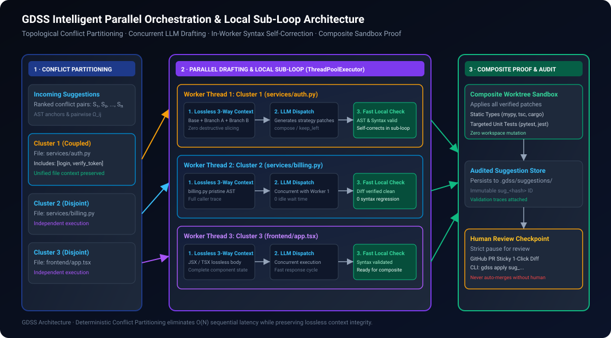
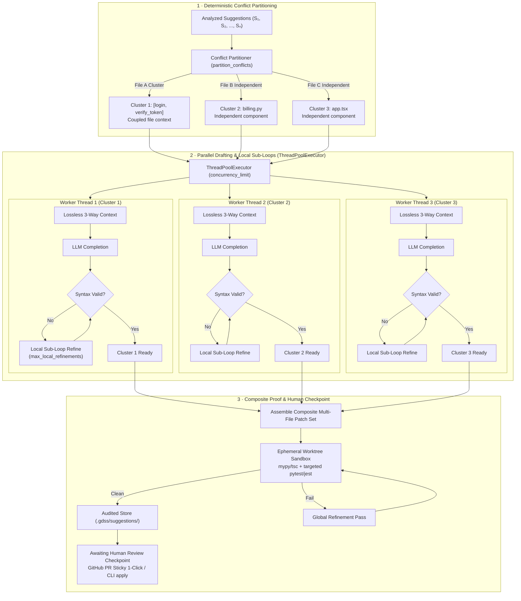
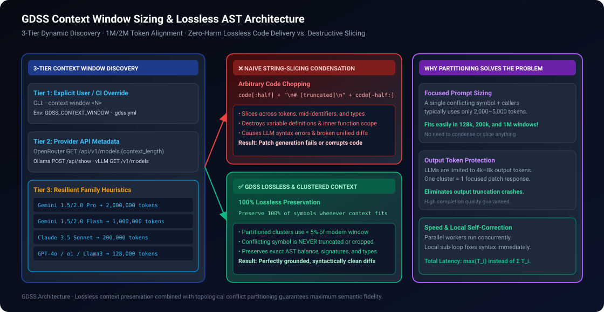

# Parallel Orchestration & Lossless Context Architecture

This guide explains how GDSS manages massive model context windows (128k to 2M tokens), eliminates destructive code condensation, and executes topological conflict partitioning to resolve multiple concurrent merge collisions in parallel with localized self-correction sub-loops.

---

## 📑 Table of Contents

- [The Core Dilemma: Context Windows vs. Conflict Scalability](#the-core-dilemma-context-windows-vs-conflict-scalability)
- [Performance & Latency Analysis: Parallel vs. Batching](#performance--latency-analysis-parallel-vs-batching)
- [End-to-End Parallel Orchestration Flow](#end-to-end-parallel-orchestration-flow)
- [Lossless Context Architecture & Zero-Harm Sizing](#lossless-context-architecture--zero-harm-sizing)
  - [3-Tier Model Context Window Discovery](#3-tier-model-context-window-discovery)
  - [Why Blind String-Slicing Was Destroying Semantics](#why-blind-string-slicing-was-destroying-semantics)
  - [The Lossless Guarantee](#the-lossless-guarantee)
- [Local Sub-Loop Refinement Mechanism](#local-sub-loop-refinement-mechanism)
- [CLI and Configuration Reference](#cli-and-configuration-reference)

---

## The Core Dilemma: Context Windows vs. Conflict Scalability

When developer teams scale their projects, concurrent pull requests frequently touch multiple files and AST symbols across the repository. A branch collision may contain 5, 10, or 20 distinct conflict points.

Historically, AI-assisted code tools faced two fatal pitfalls when attempting to resolve complex collisions:
1. **The Context Starvation Trap (Destructive Truncation):** Tools attempt to fit large files into small prompts by slicing lines in half (`[:half] + "\n# ... [truncated] ...\n" + [-half:]`). This amputates variables, inner functions, type signatures, and imports, depriving the LLM of necessary context and producing broken syntax or hallucinatory diffs.
2. **The Monolithic Batching Trap (Output Token Saturation & Loss of Attention):** Tools attempt to bundle all 10 conflicts into one massive prompt. While modern LLMs boast 128k, 200k, or even 1M–2M context windows, their **output generation limits remain capped at 4,096 to 8,192 tokens**. Synthesizing 10 multi-file patches in a single response inevitably exhausts output limits, while "lost-in-the-middle" attention degradation leads to subtle logic bugs.

GDSS resolves this through **Topological Conflict Partitioning** and **Lossless Semantic Context Allocation**.

---

## Performance & Latency Analysis: Parallel vs. Batching

Why is parallel conflict partitioning with local sub-loops faster and more reliable than a monolithic batch?

| Dimension | Monolithic Giant Batch | Sequential Drafting | Intelligent Parallel Partitioning (GDSS) |
| :--- | :--- | :--- | :--- |
| **Total Wall-Clock Latency** | $\sim 30\text{–}60\text{s}$ (long single generation) | $\sum_{i=1}^N T_{\text{LLM}}(i) \approx 40\text{–}80\text{s}$ | **$\max(T_i) \approx 4\text{–}6\text{s}$ (fast parallel round)** |
| **Output Token Risk** | **Extreme** (hits 4k/8k token ceiling) | Low (1 conflict per call) | **Zero** (1 focused patch per worker) |
| **Context Quality** | Diluted across 10 unrelated files | Lossless / Clustered | **100% Lossless & Isolated** |
| **Failure Blast Radius** | **All-or-Nothing** (1 error restarts all) | 1 at a time | **Isolated** (only failing cluster retries) |
| **Self-Correction Speed** | Re-prompts entire multi-file prompt | Global pipeline restart | **Fast Local Sub-Loop (Immediate)** |

```text
Sequential Execution (O(N)):
[---- Conflict 1 (5s) ----][---- Conflict 2 (5s) ----][---- Conflict 3 (5s) ----]  Total: 15s

Parallel Partitioned Execution (O(1)):
Worker 1: [---- Conflict 1 (5s) ----]
Worker 2: [---- Conflict 2 (4.8s) --]                                              Total: 5s (3x faster!)
Worker 3: [---- Conflict 3 (5.2s) ----]
```

---

## End-to-End Parallel Orchestration Flow

<p align="center">
  
</p>

<details>
<summary>🔄 Mermaid source (click to expand)</summary>



</details>

---

## Lossless Context Architecture & Zero-Harm Sizing

<p align="center">
  
</p>

<details>
<summary>🔄 Mermaid source (click to expand)</summary>



</details>

```mermaid
flowchart LR
    subgraph Discovery ["3-Tier Dynamic Discovery"]
        T1["Tier 1: Explicit Override<br>--context-window 1000000"]
        T2["Tier 2: Provider API<br>OpenRouter / Ollama / vLLM"]
        T3["Tier 3: Heuristics<br>Gemini: 1M-2M · Claude: 200k · GPT-4o: 128k"]
    end

    subgraph Comparison ["Context Strategy Comparison"]
        subgraph Bad ["❌ Naive String Slicing"]
            B1["code[:half] + '[truncated]' + code[-half:]"]
            B2["Cuts tokens in half · Destroys variables & scope"]
            B3["Results in broken diff headers & syntax errors"]
            B1 --> B2 --> B3
        end

        subgraph Good ["✅ GDSS Lossless & Clustered"]
            G1["Partition conflicts into focused symbol clusters"]
            G2["Each cluster uses < 5% of modern 128k-2M context"]
            G3["Conflicting symbol is 100% untouched & lossless"]
            G4["AST-aware pruning folds only distant unreferenced siblings"]
            G1 --> G2 --> G3 --> G4
        end
    end

    Discovery --> Comparison
```

### 3-Tier Model Context Window Discovery

In [`gdss/ai/condensation.py`](../gdss/ai/condensation.py), GDSS automatically aligns prompt budgets with the true capacity of the selected provider:

1. **Tier 1 (Explicit User / CI Override):** Passed via CLI `--context-window <N>`, environment variable `GDSS_CONTEXT_WINDOW=<N>`, or `.gdss.yml` configuration.
2. **Tier 2 (Dynamic Provider API Metadata):** Interrogates runtime endpoints in real time:
   - **OpenRouter:** `GET https://openrouter.ai/api/v1/models` $\rightarrow$ reads `context_length`.
   - **Ollama:** `POST http://localhost:11434/api/show` $\rightarrow$ reads `model_info.context_length`.
   - **vLLM:** `GET http://localhost:8000/v1/models` $\rightarrow$ reads `max_model_len`.
3. **Tier 3 (Resilient Family Heuristics):**
   - **Gemini 1.5 Pro / 2.0 Pro:** $2,000,000\text{ tokens}$ ($\sim 5,600,000\text{ chars}$)
   - **Gemini 1.5 Flash / 2.0 Flash:** $1,000,000\text{ tokens}$ ($\sim 2,800,000\text{ chars}$)
   - **Claude 3.5 Sonnet / 3 Opus:** $200,000\text{ tokens}$ ($\sim 560,000\text{ chars}$)
   - **GPT-4o / o1 / Llama 3.1 405B:** $128,000\text{ tokens}$ ($\sim 358,000\text{ chars}$)
   - **DeepSeek V3 / R1:** $64,000\text{ tokens}$
   - **Qwen 2.5 Coder:** $32,768\text{ tokens}$
   - **Safe Fallback:** $16,384\text{ tokens}$

### Why Blind String-Slicing Was Destroying Semantics

Earlier tools attempted to bound code by taking the first 100 lines and last 100 lines, or splitting by character index:
```python
# DESTRUCTIVE (REMOVED FROM GDSS):
condensed = code[:half] + "\n# ... [truncated] ...\n" + code[-half:]
```
This naive truncation:
- Split tokens in half (e.g. `re\n# ... [truncated] ...\nturn 42`).
- Removed variable initializations defined in the middle of a function.
- Inverted conditional blocks, removing `if` conditions while leaving un-indented `else` clauses.
- Completely destroyed unified diff line offsets, making it impossible for `git apply` to reconcile the patch.

### The Lossless Guarantee

In GDSS:
- **`condensation_mode: "lossless"` is the active default.**
- Because conflicts are partitioned by file and symbol cluster, the context block for any given conflict is focused (typically 200 to 2,000 lines).
- In a modern model with 128k to 2M tokens, a 2,000-line function consumes less than **3% of the context window**.
- **GDSS will NEVER slice or truncate the conflicting symbol.** The entire symbol, its outer signatures, and its caller references are preserved 100% losslessly.
- If a single auto-generated file genuinely exceeds the model's physical window (e.g. a 50,000-line JSON or machine-generated file), GDSS uses Tree-sitter AST parsing to collapse only unreferenced distant sibling function bodies to `...`, strictly keeping the conflicting anchor intact.

---

## Local Sub-Loop Refinement Mechanism

Rather than restarting the entire multi-suggestion convergence pipeline when a patch has a syntax error, GDSS divides self-correction into **two concentric rings**:

### 1. The Fast Local Ring (In-Worker Sub-Loop)
- Runs immediately inside the drafting thread in [`_draft_combinations()`](../gdss/ai/suggester.py).
- Performs instant in-memory AST syntax parsing and unified diff header validation via `validate_patch()`.
- If the model emitted malformed markdown backticks, invalid diff offsets, or broken syntax, the worker re-prompts the model with the exact syntax parser error.
- Completes in milliseconds without blocking other concurrent workers.

### 2. The Global Composite Ring (Sandbox Verification)
- Runs once all parallel workers have emitted syntax-clean patches in [`validate_step()`](../gdss/ai/orchestration.py).
- Applies the composite patch set into an ephemeral Git worktree sandbox.
- Executes full multi-file compiler checks (`mypy`, `tsc`, `cargo check`) and targeted test suites (`pytest`, `vitest`).
- If cross-file type mismatches occur, the global refinement loop routes the compiler trace back to the relevant strategy for targeted resolution.

---

## CLI and Configuration Reference

### Command Line Options (`gdss suggest`)

```bash
# Run parallel LLM drafting with 4 worker threads and lossless context
gdss suggest --llm --concurrency 4 --condensation lossless

# Use Gemini 1.5 Pro with explicit 2M token context window
gdss suggest --llm --provider openrouter --model google/gemini-1.5-pro --context-window 2000000

# Execute full sandboxed validation with agentic self-correction
gdss suggest --llm --validate --concurrency 4 --max-refinements 2
```

### Configuration Parameters (`.gdss.yml`)

```yaml
radar:
  # Maximum concurrent LLM drafting workers (default: 4)
  concurrency_limit: 4

  # Context condensation policy: lossless (default), ast_minimal, or off
  condensation: "lossless"

  # Explicit context window override in tokens (optional)
  context_window: 1000000

  # Maximum self-correction refinement attempts (default: 2)
  max_refinements: 2

  # Sandbox timeout in seconds
  sandbox_timeout: 30
```

